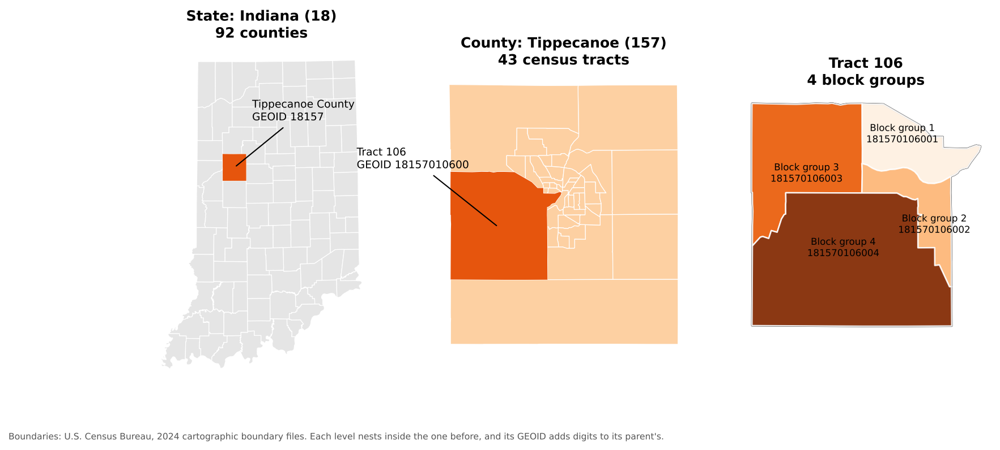
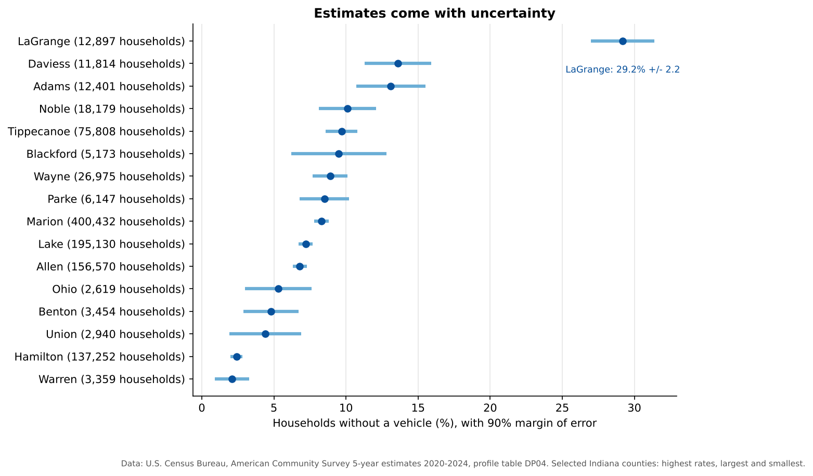
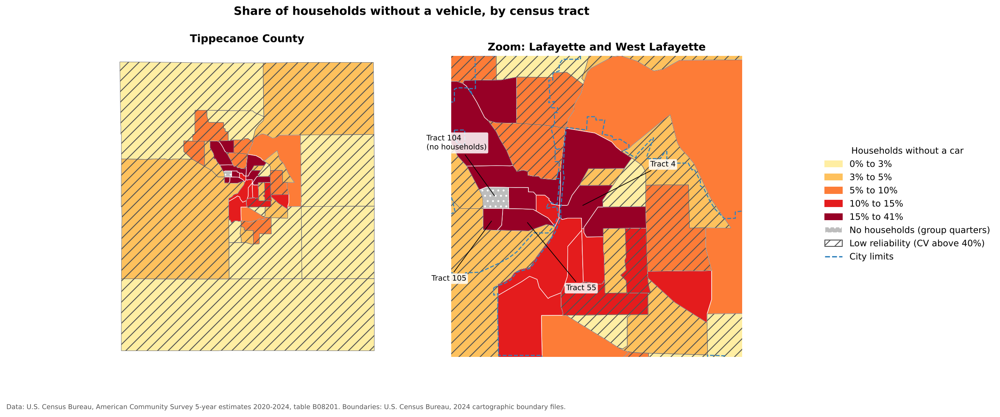

:::::::::::::::::::::::::::::::::::::: questions

- What data does the U.S. Census Bureau publish, and how is it organized?
- What is the difference between the Decennial Census and the American Community Survey?
- How do I get census data with the Census API?
- How do census tables connect to census maps?

::::::::::::::::::::::::::::::::::::::::::::::::

::::::::::::::::::::::::::::::::::::: objectives

- Describe the three main Census Bureau products: boundary files, the Decennial Census and the ACS
- Explain census geographies and how GEOIDs identify them
- Interpret ACS estimates together with their margins of error
- Build a Census API request and run it in a web browser
- Use the Python notebooks to download census data and join it to boundaries

::::::::::::::::::::::::::::::::::::::::::::::::

## Introduction

The U.S. Census Bureau is the largest source of free social and economic data about the United States.
Social scientists use it to describe neighborhoods, plan services for particular groups, choose sites for
new facilities, study the effects of policies and hazards, and much more. Three products matter most for
mapping:

1. **Boundary files** (TIGER/Line and cartographic boundary files): the shapes
2. **The Decennial Census**: a count of everyone, every ten years
3. **The American Community Survey (ACS)**: a yearly survey with detailed social and economic topics

## Census geography

The Census Bureau reports data for a hierarchy of areas. Each level nests inside the one above:

| Level | Typical size | Example in Tippecanoe County |
|---|---|---|
| State | | Indiana |
| County | | Tippecanoe County |
| Census tract | about 1,200 to 8,000 people (4,000 on average) | 43 tracts |
| Block group | about 600 to 3,000 people | Several per tract |
| Block | A city block, or a larger rural area | Smallest unit; Decennial Census only |

Other geographies do not nest neatly: **places** (cities and towns), **ZIP Code Tabulation Areas** (ZCTAs,
approximations of ZIP code areas), congressional districts, school districts and urban areas.

Every area has a **GEOID** built from **FIPS codes** (Federal Information Processing Standards codes):

| Level | Pattern | Example | Meaning |
|---|---|---|---|
| State | `SS` | `18` | Indiana |
| County | `SS` + `CCC` | `18157` | Tippecanoe County |
| Tract | `SS` + `CCC` + `TTTTTT` | `18157010600` | Tract 106 |
| Block group | tract + `G` | `181570106001` | Block group 1 of tract 106 |

{alt="Three panels. Left: Indiana's 92 counties, with Tippecanoe County, GEOID 18157, highlighted. Middle: the 43 census tracts of Tippecanoe County, small in the cities and large in rural areas, with tract 106, GEOID 18157010600, highlighted. Right: tract 106 divided into four block groups with GEOIDs 181570106001 to 181570106004."}

GEOIDs are **text**, not numbers. If a program stores `01` (Alabama) as the number `1`, it no longer
matches, which is the most common reason a table fails to join to a map.

### Boundary files

The shapes come in two families:

- **TIGER/Line** files (named `tl_...`) are the full-detail master files, published every year since 2007.
  They include legal boundaries that extend into water, and features such as roads, railroads and rivers.
- **Cartographic boundary** files (named `cb_...`) are simplified versions clipped to the shoreline, at
  1:500,000, 1:5,000,000 and 1:20,000,000 scale. They are much smaller and are the better choice for
  thematic maps.

Both are free from <https://www.census.gov/geographies/mapping-files.html> and can be read straight from
the web by QGIS or Python.

## The Decennial Census and the American Community Survey

The **Decennial Census** counts every person living in the United States every ten years (most recently in
2020). Because it is a count, it has no sampling error, but it asks only a few questions: age, sex, race,
Hispanic origin, household relationship, and whether a home is owned or rented. It is published down to
the block level.

The **American Community Survey (ACS)** is sent to about 3.5 million addresses every year. It covers topics
the Decennial Census does not, including:

- **Social**: school enrollment, educational attainment, marital status, veteran status, disability,
  language spoken at home, ancestry, place of birth
- **Economic**: income, poverty, employment, occupation, commuting, SNAP benefits, health insurance
- **Housing**: home value, rent, vehicles available, internet access, year built

| | American Community Survey | Decennial Census |
|---|---|---|
| Method | Survey of a sample | Count of everyone |
| How often | Every year | Every 10 years |
| Topics | Many social, economic and housing topics | A few basic topics |
| Margins of error | Yes | No |
| Smallest area | Block group (5-year estimates) | Block |

### 1-year and 5-year estimates

| Product | Based on | Published for | Best when |
|---|---|---|---|
| **1-year estimates** | 12 months of responses | Areas with 65,000 or more people | You need the most current numbers for a large area |
| **5-year estimates** | 60 months of responses | All areas, down to block groups | You need small areas or more reliable numbers |

The "2024 ACS 5-year estimates" pool responses from 2020 to 2024. They describe that whole period, not the
year 2024 alone. (A 3-year product also existed, but it was discontinued after the 2011 to 2013 release.)

### Margins of error

Because the ACS is a sample, every number is an **estimate** with a **margin of error** (MOE). The Census
Bureau publishes 90% margins of error: we can be 90% confident the true value lies within the estimate plus
or minus the MOE.

{alt="Dot plot of the percent of households without a vehicle in 16 Indiana counties, each with a horizontal error bar. LaGrange County is far above the rest at 29.2 percent, plus or minus 2.2. Large counties such as Marion, Lake, Allen and Hamilton have very short error bars. Small counties such as Ohio, Union, Benton, Warren and Blackford have wide error bars spanning several percentage points."}

Notice that large counties have narrow error bars and small counties have wide ones. Blackford County's
9.5% could plausibly be anywhere from about 6% to 13%. Two estimates whose ranges overlap a lot may not
really be different. A common rule of thumb uses the **coefficient of variation** (CV), the standard error
as a percentage of the estimate:

`CV = (MOE / 1.645) / estimate x 100`

A CV below 12% is usually considered highly reliable, 12% to 40% medium, and above 40% low.

::::::::::::::::::::::::::::::::::::: callout

## Why is LaGrange County so high?

LaGrange County in northern Indiana is home to one of the largest Amish communities in the United States,
and many Amish households do not own cars. Surprising values often have real explanations. Look for them
before you assume the data is wrong.

::::::::::::::::::::::::::::::::::::::::::::::::

## Three ways to get census data

| Method | Good for |
|---|---|
| [data.census.gov](https://data.census.gov/) | Browsing and downloading a table or two by clicking |
| **Census Data API** | Asking for exactly the variables and places you need, from a browser or a program; reproducible |
| Bulk files (FTP) | Downloading everything for a product at once |

The rest of this episode uses the **API**.

## The Census Data API

An **API** (Application Programming Interface) lets you request data with a web address instead of clicking
through a website. The answer comes back as a table (in JSON or CSV format) that a program can read
directly. The API only ever returns **summary data for areas**, never information about individual people.

::::::::::::::::::::::::::::::::::::: callout

## You need a free API key

The Census API now requires a key with **every** request. Without one it replies with a "Missing Key" page.
Request a key at <https://api.census.gov/data/key_signup.html>. It arrives by email within a few minutes,
and you must click the activation link in that email before it works. In the examples below, replace
`YOUR_KEY` with your own key. Treat it like a password and do not post it online.

::::::::::::::::::::::::::::::::::::::::::::::::

### Anatomy of a request

```
https://api.census.gov/data/2024/acs/acs5/profile?get=NAME,DP04_0058E&for=county:*&in=state:18&key=YOUR_KEY
```

| Part | In the example | Meaning |
|---|---|---|
| Dataset | `2024/acs/acs5/profile` | 2024 ACS 5-year estimates, data profile tables |
| `get=` | `NAME,DP04_0058E` | The variables you want, separated by commas |
| `for=` | `county:*` | The geography; `*` means all of them |
| `in=` | `state:18` | The area they are inside (Indiana) |
| `key=` | `YOUR_KEY` | Your API key |

The parts after the `?` are joined with `&`. Paste the address (with your key) into a web browser and you
will see a list of rows, one per county:

```
[["NAME","DP04_0058E","state","county"],
 ["Adams County, Indiana","1626","18","001"],
 ...
```

### Step 1: Find a dataset

The list of all datasets is at <https://www.census.gov/data/developers/data-sets.html>. Some common ones:

| Dataset path | What it is |
|---|---|
| `2024/acs/acs5` | ACS 5-year **detailed tables** (variables starting with B or C) |
| `2024/acs/acs5/profile` | ACS 5-year **data profiles** (DP): ready-made counts and percentages |
| `2024/acs/acs5/subject` | ACS 5-year **subject tables** (S) |
| `2024/acs/acs1` | ACS 1-year detailed tables (areas of 65,000 or more people) |
| `2020/dec/dp` | 2020 Decennial Census demographic profile |

### Step 2: Find your variables

Every dataset has a variables page. Add `/variables.html` to the dataset address, for example
<https://api.census.gov/data/2024/acs/acs5/profile/variables.html>. Press **Ctrl+F** (or **Cmd+F** on a Mac)
and search for words such as "no vehicles available". You will find:

| Variable | Label |
|---|---|
| `DP04_0058E` | Estimate: occupied housing units with no vehicles available |
| `DP04_0058M` | Margin of error of that estimate |
| `DP04_0058PE` | Percent of occupied housing units with no vehicles available |
| `DP04_0058PM` | Margin of error of that percent |

The last letters tell you what a variable is: **E** is an estimate, **M** its margin of error, and in the
data profiles **PE** and **PM** are the percent and its margin of error. Variable names are case-sensitive.

### Step 3: Choose the geography

| You want | Use |
|---|---|
| All states | `for=state:*` |
| All counties in Indiana | `for=county:*&in=state:18` |
| One county | `for=county:157&in=state:18` |
| All tracts in one county | `for=tract:*&in=state:18&in=county:157` |
| All tracts in a state | `for=tract:*&in=state:18` |

Tract and block group requests must name a state. State FIPS codes are listed at
<https://www.census.gov/library/reference/code-lists/ansi.html>.

### Step 4: Optional extras

- Add `&descriptive=true` to get a second header row with each variable's plain-language label.
- Add `&outputFormat=csv` to get a CSV file instead of JSON, which opens in Excel.

For example, this returns the number and percent of households without a vehicle for Tippecanoe County as
a CSV file:

```
https://api.census.gov/data/2024/acs/acs5/profile?get=NAME,DP04_0058E,DP04_0058PE&for=county:157&in=state:18&outputFormat=csv&key=YOUR_KEY
```

::::::::::::::::::::::::::::::::::::: callout

## Special values

Sometimes the API returns large negative numbers such as `-666666666`. These are **annotation codes**, not
real values. `-666666666` means the estimate could not be calculated, often because too few people were
sampled, or because almost everyone in the area lives in **group quarters** (such as university residence
halls or prisons), which are not households. Replace them with "missing" before calculating.

::::::::::::::::::::::::::::::::::::::::::::::::

The Census Bureau also has a short video: [Using the API to Access Census Data](https://www.youtube.com/watch?v=rqePUEBrcWQ).

## Hands-on: the Python notebooks

Three Google Colab notebooks put all of this into practice. They read every file straight from the web, so
there is nothing to download. Notebooks 1b and 1c need your Census API key.

| Notebook | What you will do | Open |
|---|---|---|
| 1a. Census Boundaries | Read TIGER/Line and cartographic boundary files, find FIPS codes, map counties, tracts and roads | <a href="https://colab.research.google.com/github/SpatialTurn/DataCollection/blob/main/notebooks/01a_Census_Boundaries.ipynb" target="_blank">Open in Colab</a> |
| 1b. Census API Basics | Make API requests, look up variables, use margins of error, compare the ACS and the Decennial Census | <a href="https://colab.research.google.com/github/SpatialTurn/DataCollection/blob/main/notebooks/01b_Census_API_Basics.ipynb" target="_blank">Open in Colab</a> |
| 1c. Joining Tables to Maps | Join ACS data to tract boundaries by GEOID and map households without a car, showing reliability | <a href="https://colab.research.google.com/github/SpatialTurn/DataCollection/blob/main/notebooks/01c_Joining_Tables_to_Maps.ipynb" target="_blank">Open in Colab</a> |

In Colab, choose **File > Save a copy in Drive** first so your changes are kept.

Notebook 1c ends with this map:

{alt="Two choropleth maps of the share of households without a vehicle by census tract, in five classes from light yellow (0 to 3 percent) to dark red (15 to 41 percent). Left, all of Tippecanoe County: rural tracts are light and many are hatched as low reliability. Right, a zoom on Lafayette and West Lafayette: the darkest tracts are near downtown Lafayette and the Purdue campus, such as tracts 4, 55 and 105. Tract 104, on campus, is gray because it has no households."}

The highest shares are in central Lafayette and West Lafayette, where many residents are students or live in
apartments within walking distance of shops and bus routes. Tract 104, on the Purdue campus, has more than
8,000 residents but **no households**, because nearly everyone there lives in residence halls. Hatched tracts
have estimates with low reliability.

::::::::::::::::::::::::::::::::::::: challenge

## Read a GEOID

What does the GEOID `181570104002` identify?

:::::::::::::::: solution

It has 12 characters, so it is a **block group**: state `18` (Indiana), county `157` (Tippecanoe), tract
`010400` (tract 104), block group `2`.

:::::::::::::::::::::::::

::::::::::::::::::::::::::::::::::::::::::::::::

::::::::::::::::::::::::::::::::::::: challenge

## Build an API request

Write a Census API address that returns **total population** (`B01003_001E`) and its margin of error for
**every county in Ohio** (state FIPS code `39`) from the 2024 ACS 5-year detailed tables. Then open it in
your browser with your key.

:::::::::::::::: solution

```
https://api.census.gov/data/2024/acs/acs5?get=NAME,B01003_001E,B01003_001M&for=county:*&in=state:39&key=YOUR_KEY
```

Detailed tables (variables starting with B) use the dataset path `2024/acs/acs5`, without `/profile`. Ohio
has 88 counties, so you should see 89 rows including the header.

:::::::::::::::::::::::::

::::::::::::::::::::::::::::::::::::::::::::::::

::::::::::::::::::::::::::::::::::::: challenge

## Are these really different?

Two neighboring counties report these shares of households without a vehicle:

- County A: 6.0%, margin of error 2.5
- County B: 4.5%, margin of error 2.7

Can you say County A has a higher rate than County B?

:::::::::::::::: solution

Not with confidence. County A's range is 3.5% to 8.5% and County B's is 1.8% to 7.2%. The ranges overlap a
lot, so the difference may just be sampling noise. (The Census Bureau publishes a formal significance test
for comparing two estimates, but overlapping ranges are a quick warning sign.)

:::::::::::::::::::::::::

::::::::::::::::::::::::::::::::::::::::::::::::

::::::::::::::::::::::::::::::::::::: keypoints

- Census boundary files provide the shapes; the Decennial Census and the ACS provide the numbers
- GEOIDs link tables to shapes; keep them as text
- The Decennial Census is a full count with few questions; the ACS is a yearly survey with many topics and margins of error
- Use 5-year ACS estimates for small areas, and always check margins of error
- The Census API needs a free key and lets you request exactly the variables and places you need

::::::::::::::::::::::::::::::::::::::::::::::::
