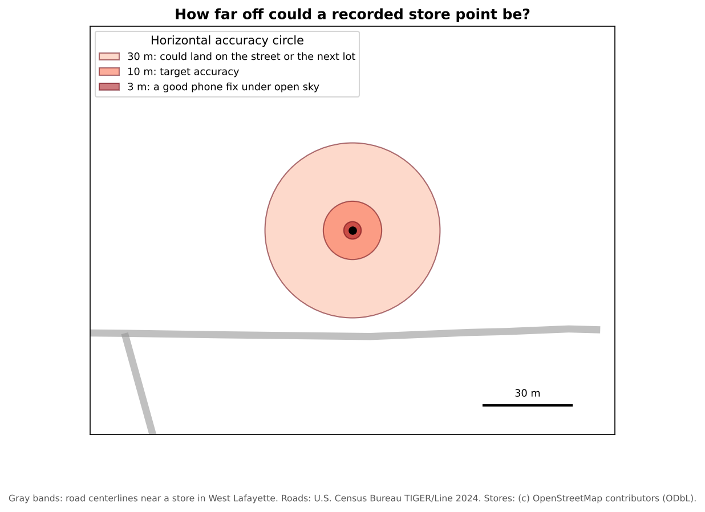

:::::::::::::::::::::::::::::::::::::: questions

- When should I collect my own geospatial data?
- How do I design a form so that field data is consistent and easy to analyze?
- How accurate is GPS on a phone, and why does it matter?
- What ethical questions come with collecting data about people and places?

::::::::::::::::::::::::::::::::::::::::::::::::

::::::::::::::::::::::::::::::::::::: objectives

- Name common methods and apps for field data collection
- Design a data schema with clear fields, data types and dropdown choices
- Explain the main sources of GPS error and how to record accuracy
- Plan for consent, privacy and safety before going into the field

::::::::::::::::::::::::::::::::::::::::::::::::

## Why collect your own data?

Existing datasets rarely describe exactly what a social scientist needs. A city may publish where bus stops
are, but not whether they have shelters. A business list may include grocery stores, but not whether they
sell fresh produce or accept SNAP benefits. When the data you need does not exist, is out of date, or cannot
be trusted, you collect it yourself.

Common methods include:

| Method | What you record | Example |
|---|---|---|
| **Observation** | Features and their condition, at a location | Sidewalk condition, store amenities, vacant lots |
| **Surveys and interviews** | People's answers, often linked to a place | Where residents shop, and how they get there |
| **Participatory mapping** | Places people draw or point to | Areas residents consider unsafe, or important |
| **Digitizing** | Features traced from maps or imagery | Buildings visible on a CORONA image |
| **Sensors** | Measurements at locations | Air quality, noise, temperature |

## Apps for field data collection

Most field data is now collected on a phone or tablet, with forms that record a location automatically.

| App | Notes |
|---|---|
| [QField](https://qfield.org/) | Free and open source; uses projects prepared in QGIS; works offline; Android, iOS, Windows, macOS and Linux |
| [Mergin Maps](https://merginmaps.com/) | Also based on QGIS projects, with built-in syncing |
| [KoboToolbox](https://www.kobotoolbox.org/) and [ODK](https://getodk.org/) | Free survey tools widely used in research and humanitarian work; strong for questionnaires, with GPS points |
| ArcGIS Field Maps and Survey123 | Esri's apps; require an ArcGIS account, which many universities provide |

This module uses **QField**, because it is free and works directly with QGIS. The
[grocery access case study](https://spatialturn.github.io/CaseStudyFoodDesert/grocery-qfield.html) in the Case Studies module walks through a
complete QField project.

## Design the data before you collect it

Field data collection fails most often not in the field, but at the desk beforehand. If every person invents
their own categories, the result cannot be analyzed. Before anyone goes out, decide on a **schema**: the list
of fields, their types and their allowed values.

| Field | Type | Allowed values | Why |
|---|---|---|---|
| `store_name` | Text | | To identify and de-duplicate stores |
| `store_type` | Dropdown | Supermarket, Convenience, Small market, Other | So stores can be compared and filtered |
| `snap_accepted` | Dropdown | Yes, No, Unknown | Access for people using benefits |
| `produce_available` | Dropdown | Yes, No, Unknown | A simple measure of healthy food |
| `photo` | Attachment | | Evidence for checking later |
| `notes` | Text | | Anything unusual, without inventing new fields |

Good practice:

- Use **dropdowns** (also called domains or value maps) wherever possible. Free text produces "SNAP", "snap",
  "EBT" and "yes" for the same thing.
- Always include **Unknown**. Guessing introduces bias; "Unknown" is honest.
- Make essential fields **required**, so a record cannot be saved without them.
- Write a **placement rule** for points, for example "stand at the main public entrance". Without one, some
  people will mark the middle of the building and others the parking lot.
- Use **short, lowercase field names without spaces** (`snap_accepted`, not `SNAP Accepted?`). They work in
  every program.
- **Test the form** on a few real sites before the full collection.

## How accurate is GPS?

Phones use **GNSS** (Global Navigation Satellite Systems: GPS, Galileo, GLONASS and BeiDou) to find their
position. Under open sky a modern phone is usually accurate to about 3 to 5 meters, but accuracy gets much
worse:

- next to tall buildings, which block satellites and bounce signals (called multipath)
- under dense trees
- indoors
- in the first moments after the app starts, before enough satellites are found

Field apps such as QField show the current **accuracy** as a circle around your position and a number in
meters. Wait until it settles, set a target (for example, under 10 m), and record the accuracy with every
point. External GNSS receivers can reach sub-meter or even centimeter accuracy, at extra cost.

{alt="A store location in West Lafayette drawn as a black dot, surrounded by three accuracy circles: 3 meters (a good phone fix under open sky), 10 meters (the target), and 30 meters, which reaches toward the road and neighboring lots. A scale bar shows 30 meters."}

Does a few meters matter? For counting stores in a county, rarely. For measuring walking distance to a store
entrance, or deciding which side of a boundary a store is on, it can.

## Ethics, privacy and safety

Collecting data about places often means collecting data about people. Before you start:

- **Get approval.** Research with human participants (surveys, interviews, photos of people) usually needs
  review by your institution's Institutional Review Board (IRB).
- **Ask for consent**, and explain how the data will be used and shared.
- **Protect privacy.** A precise location can identify a person or a household. Avoid recording home
  locations unless you must; if you do, store them securely, and share only aggregated or generalized
  versions.
- **Respect property and people.** Stay on public land unless you have permission. Do not photograph people
  without consent.
- **Stay safe.** Work in pairs, tell someone your route, and carry a charged phone.
- **Keep field notes.** Record the date, the team, the weather, problems and decisions. They become part of
  your metadata.

## Check the data quickly (quality assurance)

Review the data **the same day** while you still remember what you saw:

1. **Completeness**: are required fields filled in?
2. **Location**: do points fall where they should, inside the study area?
3. **Duplicates**: is the same place recorded twice?
4. **Consistency**: are categories used the same way by everyone?
5. **Evidence**: do photos match their records?

::::::::::::::::::::::::::::::::::::: challenge

## Design a schema

You are mapping **bus stops** in your city to study accessibility for wheelchair users. List five fields you
would collect, with their type and allowed values.

:::::::::::::::: solution

One possible schema:

| Field | Type | Allowed values |
|---|---|---|
| `stop_id` | Text | Code shown on the stop sign, to match the transit agency's data |
| `shelter` | Dropdown | Yes, No, Unknown |
| `bench` | Dropdown | Yes, No, Unknown |
| `curb_ramp` | Dropdown | Yes, No, Unknown |
| `surface` | Dropdown | Paved pad, Grass or dirt, Other |
| `photo` | Attachment | |
| `notes` | Text | |

A placement rule, such as "stand at the stop sign", keeps the points consistent.

:::::::::::::::::::::::::

::::::::::::::::::::::::::::::::::::::::::::::::

::::::::::::::::::::::::::::::::::::: challenge

## Spot the problems

Three volunteers mapped the same neighborhood. Here are some of their records:

| store_name | store_type | snap_accepted | gps_accuracy_m |
|---|---|---|---|
| Fresh Foods | supermarket | yes | 4 |
| Fresh Foods Market | Supermarket | EBT | 6 |
| Corner Stop | gas station | | 38 |

What problems can you find, and how would a better form have prevented them?

:::::::::::::::: solution

- The first two rows are probably the **same store** entered twice with different names. A QA check for
  nearby points with similar names would find it.
- `store_type` uses inconsistent capitalization and a category ("gas station") that is not on the list. A
  **dropdown** prevents both.
- `snap_accepted` has "yes" and "EBT", and one blank. A Yes, No, Unknown dropdown, made **required**, fixes
  this.
- An accuracy of 38 m is poor. The volunteer should have waited for a better fix, or written a note.

:::::::::::::::::::::::::

::::::::::::::::::::::::::::::::::::::::::::::::

::::::::::::::::::::::::::::::::::::: keypoints

- Collect your own data when what you need does not exist or cannot be trusted
- Design the schema first: clear fields, dropdowns, an "Unknown" option and a placement rule
- Phone GPS is typically accurate to a few meters under open sky, and much worse near buildings and trees; record accuracy
- Plan for consent, privacy and safety before collecting data about people and places
- Check data the same day it is collected

::::::::::::::::::::::::::::::::::::::::::::::::
