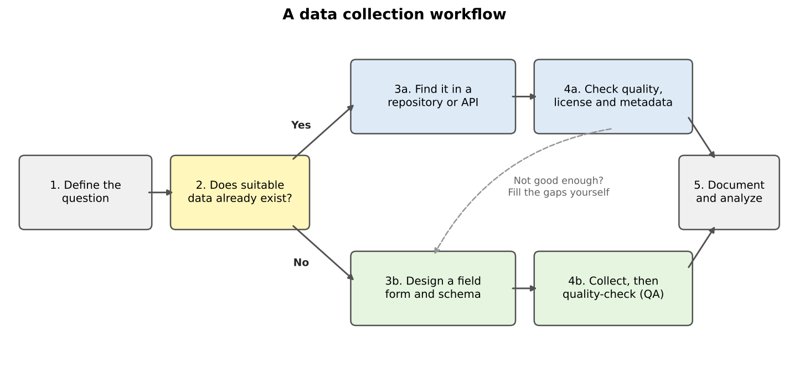
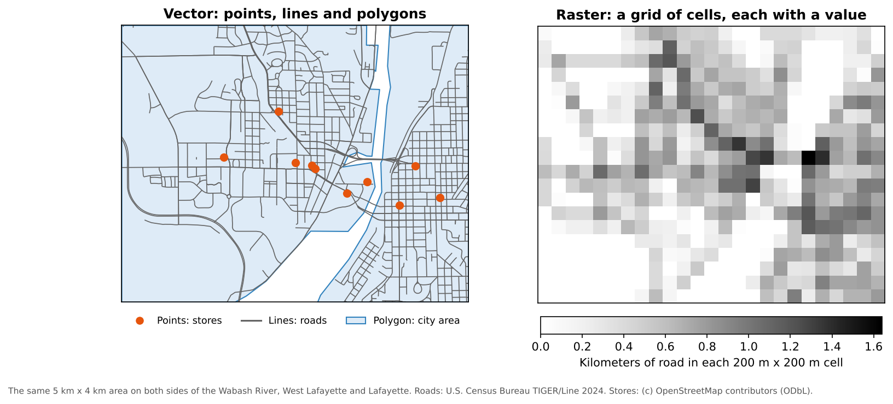

:::::::::::::::::::::::::::::::::::::: questions

- Should I use existing data or collect my own?
- What kinds of geospatial data will I meet in this module?
- How can I tell whether a dataset is good enough for my project?

::::::::::::::::::::::::::::::::::::::::::::::::

::::::::::::::::::::::::::::::::::::: objectives

- Describe the main steps of a data collection workflow
- Distinguish vector data from raster data
- Evaluate a dataset using a checklist of quality, license and metadata questions
- Explain what the FAIR principles mean for data you collect and share

::::::::::::::::::::::::::::::::::::::::::::::::

## Why data collection matters

Every map and every spatial analysis is only as good as the data behind it. For social scientists, the
first decision in a project is often the most important one: **can I use data that already exists, or do
I need to collect my own?**

Pre-existing data is everywhere. Governments publish census statistics, administrative boundaries, roads
and land cover. Universities run geoportals full of scanned maps and research datasets. Satellites have
photographed the whole planet many times over. Using these sources saves time and money, and makes your
work easier for others to repeat.

But existing data is not always enough. It may be out of date, too coarse, missing the attribute you
need, or simply not exist for your topic. Then you collect original data: with a survey, a field visit,
interviews, or by digitizing features from maps and imagery.

{alt="Flow diagram. Step 1, define the question, leads to step 2, does suitable data already exist? If yes, step 3a, find it in a repository or API, then step 4a, check quality, license and metadata. If no, step 3b, design a field form and schema, then step 4b, collect and quality-check. Both paths end at step 5, document and analyze. A dashed arrow from 4a to 3b says: not good enough? Fill the gaps yourself."}

The two paths often meet. In the case study used later in this module, we take **census data** and
**road data** from government sources, then add **grocery store locations** that could be checked or
collected in the field, because no official list says where every store is, what it sells, and whether
it accepts SNAP benefits.

## What this module covers

| Episode | Kind of data | Tools |
|---|---|---|
| Finding Data in Repositories | Vector data from geoportals and open data hubs | Web browser, QGIS |
| Data from the U.S. Census Bureau | Census boundaries and statistics | Web browser, Python (Colab) |
| Acquiring Imagery | Scanned maps and satellite imagery (raster) | Web browser, QGIS |
| Collecting Data in the Field | Original observations | QField, QGIS |
| QField demonstration | Mapping grocery stores | QField, QGIS |
| Network Analysis for Grocery Access | Using the collected data | QGIS |

## Vector and raster data

Geospatial data comes in two basic forms.

- **Vector** data stores features as **points** (a store), **lines** (a road) or **polygons** (a city
  boundary), each with a row of attributes in a table. Census boundaries, roads and field observations
  are vector data.
- **Raster** data is a grid of cells (pixels), each holding a value: a color, an elevation, a land cover
  class, a temperature. Satellite images, scanned maps and elevation models are rasters.

{alt="Two panels of the same 5 by 4 kilometer area of West Lafayette and Lafayette. Left, vector: orange store points, gray road lines and a light blue city polygon. Right, raster: a grid of 200 meter gray cells, darker where there is more road length in the cell, so the road pattern appears as a blocky texture."}

| | Vector | Raster |
|---|---|---|
| Represents | Discrete features with clear edges | Continuous surfaces, or images |
| Examples | Tracts, roads, stores, survey points | Satellite images, elevation, land cover |
| Detail | Set by the precision of coordinates | Set by the cell size (resolution) |
| Common formats | GeoJSON, shapefile, GeoPackage | GeoTIFF, JPEG2000, NetCDF |

Neither is better; they answer different questions, and many projects use both. A satellite image (raster)
might be traced to create building outlines (vector), and census tracts (vector) might be used to summarize
a land cover map (raster).

## Is this dataset good enough?

Before you build a project on someone else's data, ask:

| Question | Why it matters |
|---|---|
| **Who made it, and how?** | A government survey, a crowd-sourced map and a student project differ in method and reliability |
| **When?** | Boundaries, roads and stores change. Is it recent enough for your question? |
| **Where, and at what detail?** | Coverage, resolution or scale must match your study area and question |
| **What exactly is measured?** | Read the definitions. "Grocery store" or "household" may not mean what you assume |
| **How accurate is it?** | Look for margins of error, positional accuracy and known gaps |
| **What coordinate system?** | You will need it to line layers up correctly |
| **Can I use it?** | Check the license: some data is public domain, some requires credit, some cannot be shared |

Most of these answers are in the dataset's **metadata**: the documentation that describes the data. Data
without metadata is a warning sign.

## FAIR data

When you collect or share data yourself, aim to make it **FAIR**:

- **Findable**: it has a clear name, a description and, ideally, a persistent identifier such as a DOI
- **Accessible**: others can retrieve it, for example from a repository, even if access is controlled
- **Interoperable**: it uses common formats and standard codes (GeoJSON, GEOIDs, EPSG codes)
- **Reusable**: it has a license, a description of methods, and enough metadata for someone else to use it
  correctly

Field data that sits in one person's phone, with column names only they understand, is none of these
things. The QField episodes show how a planned form, consistent categories and good notes make field data
reusable.

::::::::::::::::::::::::::::::::::::: challenge

## Existing data or new data?

For each research question, decide whether you would start with existing data, collect your own, or both.
Name a possible source.

1. How has median household income changed in Indiana counties since 2015?
2. Which bus stops in your city have a bench and a shelter?
3. How much forest was lost around a national park between 1970 and today?

:::::::::::::::: solution

1. **Existing data.** The American Community Survey publishes median household income for every county
   every year (Data from the U.S. Census Bureau episode).
2. **Probably both.** A transit agency may publish stop locations, but amenities such as benches are often
   missing or out of date, so you would check them in the field.
3. **Existing imagery.** Declassified CORONA images (1960 to 1972) and modern Landsat or Sentinel-2 images
   can be compared (Acquiring Imagery episode). You might verify a sample of areas in the field.

:::::::::::::::::::::::::

::::::::::::::::::::::::::::::::::::::::::::::::

::::::::::::::::::::::::::::::::::::: challenge

## Vector or raster?

Would each of these usually be stored as vector or raster data?

1. Locations of public libraries
2. Air temperature across a state
3. School district boundaries
4. A scanned 1890 city map

:::::::::::::::: solution

1. Vector (points)
2. Raster (a continuous surface)
3. Vector (polygons)
4. Raster (an image), until you trace features from it into vector layers

:::::::::::::::::::::::::

::::::::::::::::::::::::::::::::::::::::::::::::

::::::::::::::::::::::::::::::::::::: keypoints

- Start every project by asking whether suitable data already exists
- Vector data stores discrete features; raster data stores values in a grid of cells
- Check who made a dataset, when, how, at what detail, with what accuracy, and under what license
- Make the data you collect FAIR: findable, accessible, interoperable and reusable

::::::::::::::::::::::::::::::::::::::::::::::::
