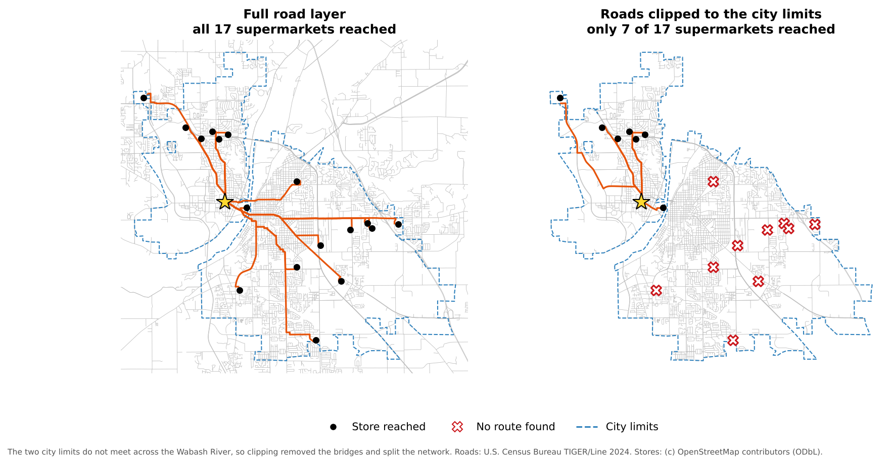
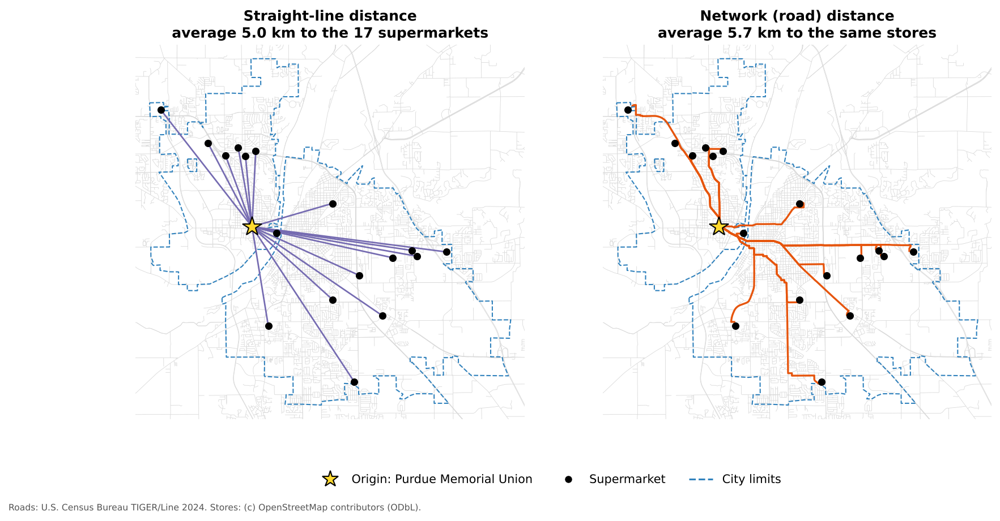
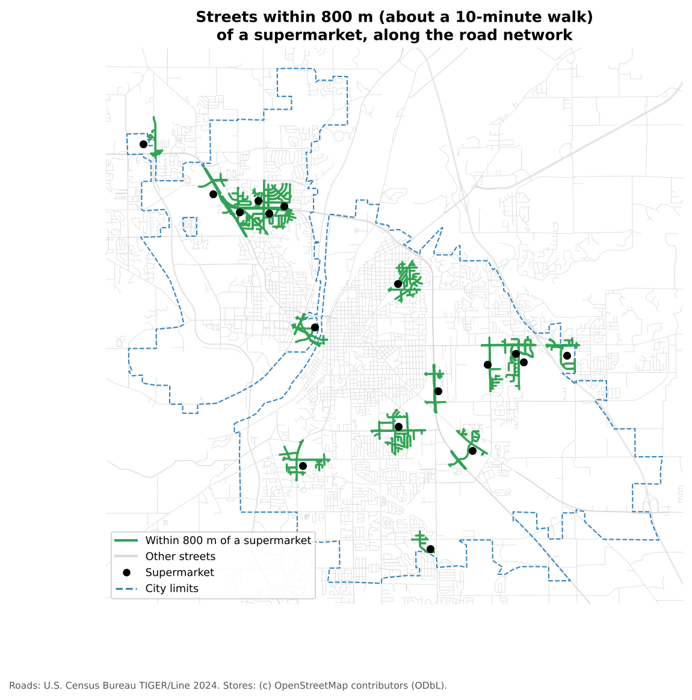

::::::::::::::::::::::::::::::::::::: questions

- How do we move from grocery store points to an analysis of travel along roads?
- How do shortest path and service area tools in QGIS answer different questions about access?
- Why is network distance often better than straight-line distance for access studies?

:::::::::::::::::::::::::::::::::::::::::::::::

::::::::::::::::::::::::::::::::::::: objectives

- Load grocery store, road and study area layers into QGIS from the web
- Reproject layers to a projected coordinate system so that distances are in meters
- Calculate shortest paths from one origin to every supermarket
- Generate service areas that show which streets are within walking distance of a supermarket
- Recognize data problems that break network analysis

:::::::::::::::::::::::::::::::::::::::::::::::

## Overview

In the previous episode, a team mapped grocery stores in the field with QField. In this episode, we use
grocery store points with a road network to ask a new question:

**How accessible are grocery stores when movement is limited to the road network?**

This episode moves from **data collection** to **analysis**. Instead of treating distance as a straight line,
we measure routes along streets.

Imagine that a class, a community partner or a student group wants to know how easy it is to reach a
supermarket from a residence hall, an apartment complex or a neighborhood. We will:

1. prepare the grocery store and road data
2. calculate routes from one starting point to every supermarket
3. create service areas showing the streets within a chosen distance of a supermarket

## The data

Three small files are stored in this lesson's repository. You do not need to download them; QGIS reads them
straight from the web.

| Layer | Contents | Source |
|---|---|---|
| `grocery_stores` | 64 food stores in and around Lafayette and West Lafayette: 17 supermarkets, 2 wholesale stores and 45 convenience stores | OpenStreetMap contributors (Open Database License), October 2026 |
| `roads` | 3,466 road segments covering both cities and a margin around them | U.S. Census Bureau, TIGER/Line 2024 |
| `study_area` | The city limits of Lafayette and West Lafayette | U.S. Census Bureau, 2024 cartographic boundary files |

The store points stand in for data collected with QField. In a real project, the team would have verified
them in the field first.

::::::::::::::::::::::::::::::::::::: prereq

## Before you begin

- QGIS installed (see [Setup](../learners/setup.md))
- Basic familiarity with the QGIS interface, for example from the Data Visualization module's
  "Getting Started with QGIS" episode

::::::::::::::::::::::::::::::::::::::::::::::::

## Step 1: Load and inspect the layers

1. Open QGIS and start a new project.
2. Go to **Layer > Add Layer > Add Vector Layer**.
3. For **Source Type**, choose **Protocol: HTTP(S), cloud, etc.** and leave **Type** as **HTTP/HTTPS/FTP**.
4. Paste the first address into **URI**, click **Add**, and repeat for the other two:

   ```
   https://raw.githubusercontent.com/SpatialTurn/DataCollection/main/data/grocery_stores.geojson
   https://raw.githubusercontent.com/SpatialTurn/DataCollection/main/data/roads.geojson
   https://raw.githubusercontent.com/SpatialTurn/DataCollection/main/data/study_area.geojson
   ```

5. Click **Close**. In the **Layers** panel, drag `grocery_stores` to the top so the points draw above the
   roads.
6. Right-click `grocery_stores` and choose **Open Attribute Table**. Look at the fields: `store_name`,
   `store_type`, `address`, `city`, `osm_id`, `source` and `verification`.

Before analyzing anything, look for problems:

- duplicate points
- stores outside the study area
- stores with no name or address
- roads that look disconnected from the rest

::::::::::::::::::::::::::::::::::::: challenge

## Quick inspection

Look at the map and the attribute table. What do you notice? Which kinds of data problems would most directly
affect a network analysis?

:::::::::::::::: solution

You may notice that six convenience stores, such as a Love's travel stop, lie **just outside the city
limits**. Stores like these should usually stay in an analysis, because city residents shop there too. (All 17
supermarkets are inside the city limits.) A few convenience stores have **no
name**, and several stores have **no address**. Two **Fresh Thyme** points might look like duplicates, but they
are two different stores, one in each city; check before deleting anything.

The problems that most directly affect a network analysis are those that affect where a route starts or ends:

- a store point placed far from any road
- duplicate stores, which inflate the number of destinations
- disconnected road segments, which break routes
- layers in different coordinate systems, which appear in the wrong place

:::::::::::::::::::::::::

::::::::::::::::::::::::::::::::::::::::::::::::

## Step 2: Keep only the supermarkets

Convenience stores rarely sell a full range of fresh food, so food access studies usually focus on
supermarkets.

1. Open the **Processing Toolbox** (**Processing > Toolbox**).
2. Search for **Extract by attribute** and open it.
3. Set **Input layer** to `grocery_stores`, **Selection attribute** to `store_type`, **Operator** to `=`,
   and **Value** to `Supermarket`.
4. Click **Run**. A new layer called **Extracted (attribute)** appears with 17 supermarkets. Rename it
   `supermarkets` (right-click > **Rename Layer**).

## Step 3: Reproject the data

Network analysis should be done in a **projected** coordinate system, so that distances are measured in
meters rather than degrees. The files are stored in latitude and longitude (EPSG:4326). For Lafayette, a good
choice is **NAD83 / UTM zone 16N (EPSG:26916)**.

1. In the Processing Toolbox, search for **Reproject layer** and open it.
2. Set **Input layer** to `supermarkets` and **Target CRS** to **EPSG:26916**.
3. Click **Run**, and rename the output `supermarkets_utm`.
4. Repeat for `roads` (rename the output `roads_utm`) and `study_area` (`study_area_utm`).
5. Set the **project** coordinate system too: click the CRS button in the bottom-right corner of the QGIS
   window (it shows something like **EPSG:4326**), search for **26916**, select **NAD83 / UTM zone 16N**, and
   click **OK**.

::::::::::::::::::::::::::::::::::::: caution

## Why set the project CRS as well?

QGIS's network tools report travel cost in the units of the **project's** coordinate system. If the project is
still in EPSG:4326, a 4 km route is reported as a cost of about 0.036 (degrees). With the project in
EPSG:26916, the same route has a cost of about 4,000 (meters).

Do not assume that layers are ready for analysis just because they draw in the same place. Check the CRS of
each layer (right-click > **Properties > Information**).

::::::::::::::::::::::::::::::::::::::::::::::::

## Step 4: Do not clip the roads too tightly

It is tempting to clip the road layer to the city limits to make it smaller. Here, that is a mistake. The
road file already stops a short distance outside the two cities, and the city limits are irregular: they do
not even meet each other across the Wabash River. Clipping the roads to them removes the bridges and splits
the network into pieces.

{alt="Two maps of Lafayette and West Lafayette. Left: with the full road layer, orange routes run from the origin star in West Lafayette to all 17 supermarkets. Right: with roads clipped to the irregular, dashed city limits, the network is split at the Wabash River and only the 7 supermarkets in West Lafayette are reached; the 10 in Lafayette are marked with red crosses."}

With the full road layer, all 17 supermarkets can be reached. With roads clipped to the city limits, only 7
can. When you do clip a network, clip it to a generous rectangle or buffer around your study area, never to an
irregular boundary.

## Step 5: Choose a starting point

Our origin is the **Purdue Memorial Union**, in the center of campus. You will set it inside the shortest path
tool in the next step, either by clicking on the map or by typing its coordinates:

```
507575, 4474900 [EPSG:26916]
```

::::::::::::::::::::::::::::::::::::: discussion

## Why start with one origin?

Why might it be better to start with a single origin before moving on to many homes or neighborhoods?

A single origin keeps the first analysis easy to read. You can inspect the routes, compare stores and find
problems with snapping or connectivity before moving to a more complex workflow with many origins.

::::::::::::::::::::::::::::::::::::::::::::::::

## Step 6: Shortest paths to every supermarket

1. In the Processing Toolbox, search for **Shortest path (point to layer)** and open it.
2. Set the parameters:
   - **Vector layer representing network**: `roads_utm`
   - **Path type to calculate**: **Shortest**
   - **Start point (x, y)**: click the **...** button, then click the Purdue Memorial Union on the map, or
     paste the coordinates from Step 5
   - **Vector layer with end points**: `supermarkets_utm`
   - **Shortest path**: leave as a temporary layer
   - **Non-routable features**: leave as a temporary layer
3. Click **Run**.

You now have a line layer, **Shortest path**, with one route from the origin to each supermarket. Its `cost`
field is the route length in meters.

::::::::::::::::::::::::::::::::::::: callout

## When a store cannot be reached

If a store cannot be reached through the network, its route has an empty (**NULL**) cost. Stores that cannot
be connected to the network at all are listed in the **Non-routable features** layer. Both usually point to a
data problem: a store far from any road, a gap in the network, or a network clipped too tightly.

::::::::::::::::::::::::::::::::::::::::::::::::

## Step 7: Compare network and straight-line distance

1. Style the **Shortest path** layer with a bold, bright line, the supermarkets with a distinct point symbol,
   and the roads in light gray.
2. Open the attribute table of **Shortest path** and click the **Field Calculator** button (the abacus icon).
3. Create a new field `route_km` (**Decimal number**) with the expression `"cost" / 1000`.
4. Create another field `straight_km` with the expression
   `distance(start_point($geometry), end_point($geometry)) / 1000`. This is the straight-line distance
   between the two ends of the route.
5. Create a third field `detour` with the expression `"route_km" / "straight_km"`.
6. Close the Field Calculator, turn off editing (save the edits), and sort the table by `route_km`.

{alt="Two maps of Lafayette and West Lafayette with an origin star at the Purdue Memorial Union and 17 black supermarket points. Left: purple straight lines radiate from the origin to each supermarket, averaging 5.0 kilometers. Right: orange routes follow the streets to the same stores, averaging 5.7 kilometers, crossing the Wabash River on the bridges near downtown Lafayette."}

The nearest supermarket by road is about 1.3 km away. On average, routes are about 14% longer than straight
lines, and some are much longer: the Walmart Supercenter on Veterans Memorial Parkway is 8.0 km away in a
straight line but about 10.1 km by road, a detour of about 1.3. The river, the few bridges, railroads and
cul-de-sacs all force detours.

::::::::::::::::::::::::::::::::::::: challenge

## Interpreting route results

A store looks close on the map, but its route is much longer than expected. Name two possible reasons.

:::::::::::::::: solution

- The street network requires a detour, for example because there is no bridge or direct road
- The store or the origin snapped to a different road segment than you expected
- Barriers such as rivers, railroads, highways with few crossings, or cul-de-sacs
- The store point is slightly off its true entrance, for example in the middle of a large parking lot

:::::::::::::::::::::::::

::::::::::::::::::::::::::::::::::::::::::::::::

## Step 8: Service areas around supermarkets

Shortest paths answer the question: **how do I get from one place to each store?**

Service areas answer a different question: **which streets are within a given distance of a store?**

1. In the Processing Toolbox, search for **Service area (from layer)** and open it.
2. Set the parameters:
   - **Vector layer representing network**: `roads_utm`
   - **Vector layer with start points**: `supermarkets_utm`
   - **Path type to calculate**: **Shortest**
   - **Travel cost**: `800` (meters, about a 10-minute walk)
3. Click **Run**.

The output, **Service area (lines)**, shows the parts of the street network you can reach within 800 m of a
supermarket.

{alt="Map of Lafayette and West Lafayette roads in light gray, with green street segments around each of the 17 supermarkets showing the streets within 800 meters along the network. The green areas are small clusters around stores, mostly along the commercial corridors; most streets, including downtown Lafayette and much of the Purdue campus area, are gray."}

Only about 11% of the street length inside the two cities is within an 800 m walk of a supermarket. Most
supermarkets sit on commercial corridors at the edges of the cities, designed for people who drive.

## Step 9: Interpret the results

Service areas support questions such as:

- Which parts of the study area appear well served by the current supermarkets?
- Which neighborhoods appear poorly connected?
- How does the answer change with a travel cost of 400 m, 800 m or 1,600 m?

Combine this with the census map from the Census episode. Of the six census tracts with the highest share of
households **without a car**, four (tracts 4, 7, 105 and 112, in central Lafayette and around the Purdue campus)
have almost no streets within 800 m of a supermarket. That is exactly where a food access problem would be
expected.

Remember that the result is only as good as the network and the assumptions behind it:

- A road centerline layer does not show sidewalks, crosswalks or footpaths
- Highways appear walkable in the network, but are not
- Verified store points improve the destinations, but cannot fix a poor road layer

::::::::::::::::::::::::::::::::::::: discussion

## Reflection

What parts of real-world access are still missing from this analysis, even after using a network instead of
straight-line distance?

Possible answers include sidewalk quality, crosswalks, traffic safety, bus routes, store hours, prices, food
quality, disability access, and whether a road is really walkable.

::::::::::::::::::::::::::::::::::::::::::::::::

::::::::::::::::::::::::::::::::::::: challenge

## Change the distance

Run **Service area (from layer)** again with a travel cost of `1600` (about a 20-minute walk). How does the
picture change?

:::::::::::::::: solution

The share of city streets within reach rises from about 11% to about 40%, and the green areas begin to join
along the main corridors. But some areas are still left out: tract 105, beside the Purdue campus, where more
than 40% of households have no car, has no streets within 1,600 m of a supermarket along the network. Walking 20 minutes each way with groceries is a real burden, which is why access studies also
consider car ownership and public transit.

:::::::::::::::::::::::::

::::::::::::::::::::::::::::::::::::::::::::::::

## Step 10: Save your outputs

Temporary layers disappear when QGIS closes. To keep them, right-click each one and choose
**Export > Save Features As...**, and save it to a GeoPackage (for example `grocery_access.gpkg`) with a
different **Layer name** for each:

- `supermarkets_utm`
- `roads_utm`
- `shortest_paths`
- `service_area_800m`

Then save the project (**Project > Save**). These outputs can be reused to join service areas to census data,
to design a map layout, or to compare neighborhoods.

:::::::::::::::::::::::::::::::: instructor

## Instructor notes

**Suggested pacing**: loading and inspection 10 minutes; extracting and reprojecting 15; shortest paths 15;
comparing distances 10; service areas 15; discussion and challenges 15.

**Teaching strategy**: keep the lesson focused on one idea: network distance differs from straight-line
distance. Connect it to the census episode's map of households without a car.

**Common learner problems**:

- the project CRS is left in EPSG:4326, so costs appear in degrees
- layers are not reprojected consistently
- the road network is clipped too tightly (show the clipping figure)
- learners confuse service areas with buffers (a buffer ignores roads)
- outputs are left as temporary layers and lost

**Extensions**: compare shortest and fastest paths; build a layer of several origins (residence halls or
apartment complexes); convert service area lines to polygons with the **Concave hull** tool; join service
areas to census tracts.

::::::::::::::::::::::::::::::::::::::::::::::::

::::::::::::::::::::::::::::::::::::: keypoints

- Grocery store points become far more useful for access questions when combined with a road network
- Reproject layers and set the project CRS to a projected system so that costs are in meters
- Shortest path tools compare routes; service area tools show which streets are within reach
- Network distance is longer than straight-line distance, sometimes by much more than expected
- Clipping a network to an irregular boundary can break routes; check for unreachable destinations

::::::::::::::::::::::::::::::::::::::::::::::::
